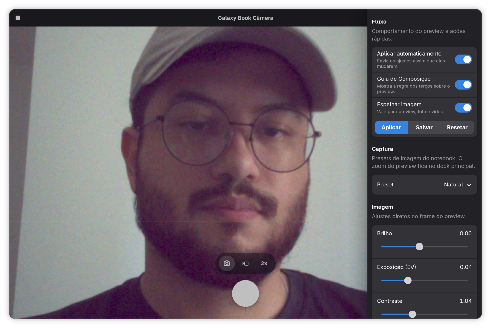
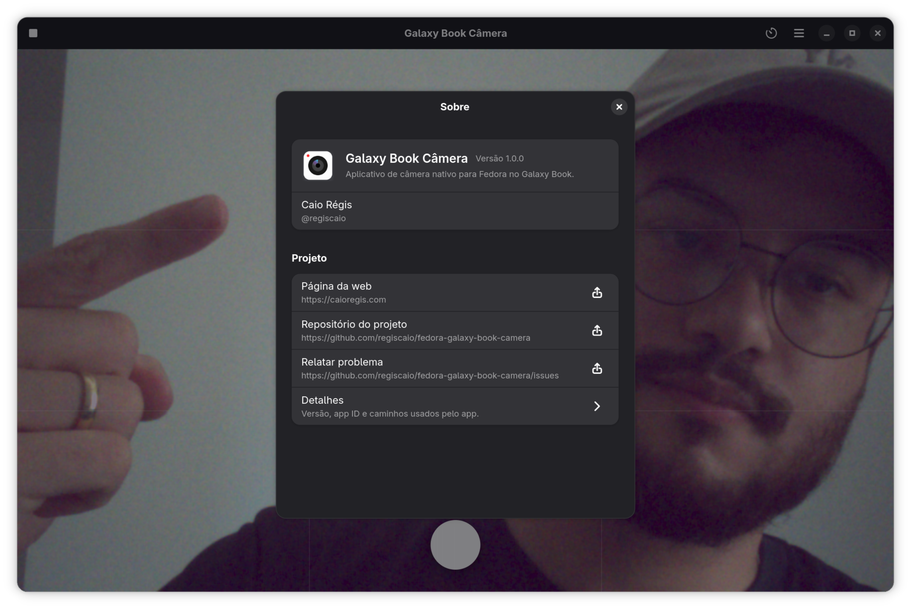

<p align="center">
  
</p>

<h1 align="center">Galaxy Book Camera</h1>

<p align="center">
  <a href="README.md">🇧🇷 Português</a> 
  <a href="README.en.md">🇺🇸 English</a> 
  <a href="README.es.md">🇪🇸 Español</a> 
  <a href="README.it.md">🇮🇹 Italiano</a>
</p>

## Instalación rápida

Para instalar la app desde el repositorio DNF público:

```bash
sudo dnf config-manager addrepo --from-repofile=https://packages.caioregis.com/fedora/caioregis.repo
sudo dnf install galaxybook-camera galaxybook-setup
```

La app sigue siendo independiente del driver; usa Galaxy Book Setup para
aprovisionar y validar la cámara interna.

`Galaxy Book Camera` es una app de cámara para Fedora en portátiles Samsung
Galaxy Book, con foco actual en el **Galaxy Book4 Ultra**. La app usa
`libcamera` directamente, tiene UI nativa de GNOME con `GTK4` y `libadwaita`,
y fue pensada para funcionar junto al driver empaquetado en
[`fedora-galaxy-book-ov02c10`](https://github.com/regiscaio/fedora-galaxy-book-ov02c10).

Este repositorio cubre solo el **lado userspace**: interfaz, captura de fotos,
grabación de vídeo y ajustes de imagen. El módulo del kernel vive en un
repositorio separado.

## Interfaz actual

### Pantalla principal



### Modal `Sobre`



## Estado actual

En el estado validado en agosto de 2026, la app ya cubre el flujo principal de
cámara en el Galaxy Book4 Ultra:

- vista previa directa vía `libcamera`;
- foto y vídeo con UI nativa de GNOME;
- zoom expuesto en el dock principal;
- tuning dedicado del sensor `ov02c10` para reducir el fallback totalmente
  `uncalibrated` de `libcamera`;
- integración con el driver `ov02c10` empaquetado y con `Galaxy Book Setup`.

El flujo para navegador, Meet, Discord, Teams y otras apps WebRTC sigue
dependiendo del setup del host, por eso ese camino sigue documentado y
automatizado en `Galaxy Book Setup`.

En el estado actual del stack, la app nativa de cámara de Fedora/GNOME ya
puede funcionar en este portátil. Aun así, ambos caminos no entregan
exactamente el mismo resultado visual:

- la app nativa de Fedora tiende a mostrar una imagen más procesada, con color,
  balance de blancos y apariencia general más “listos”;
- `Galaxy Book Camera` usa una ruta directa vía `libcamera`, visualmente más
  cruda y más cercana al sensor, preservando más detalle fino y ofreciendo un
  control mucho más flexible sobre la imagen.

En la práctica, la app nativa puede parecer mejor en color en el estado por
defecto, mientras que `Galaxy Book Camera` tiende a entregar mejor detalle y
más margen de ajuste.

## Por qué existe una app dedicada

La app nativa de cámara de GNOME fue una referencia importante de interfaz e
integración con el escritorio, pero no resuelve por sí sola el caso específico
del Galaxy Book4 Ultra.

En este hardware, la webcam depende de una combinación más sensible entre:

- driver `ov02c10` fuera de la ruta in-tree pura del kernel;
- stack Intel IPU6;
- `libcamera` y el paquete de módulos IPA `libcamera-ipa`;
- bridge para navegador y comunicadores cuando hace falta.

En la práctica, la ruta genérica del escritorio no siempre era el mejor lugar
para validar el sensor, la vista previa y los ajustes específicos de este
portátil. `Galaxy Book Camera` existe justamente para:

- hablar directamente con `libcamera` en el flujo principal de la cámara;
- cargar un tuning propio del sensor `ov02c10`;
- exponer la interfaz y los controles que tenían sentido para este hardware;
- priorizar detalle y control fino de la captura, en vez de depender solo del
  procesamiento estándar de la ruta genérica del escritorio;
- separar el uso diario de la cámara del flujo de reparación, diagnóstico y
  bridge, que quedó concentrado en `Galaxy Book Setup`.

En otras palabras: el objetivo no fue “sustituir la app nativa de Fedora por
gusto”, sino crear una ruta estable y controlable para un hardware que necesitó
una solución dedicada.

## Alcance

El proyecto ofrece:

- vista previa embebida en la ventana principal;
- selector de zoom en el dock principal, con niveles `1x`, `2x`, `3x`, `5x` y
  `10x`;
- captura de fotos en la mayor resolución still expuesta por la cámara;
- grabación de vídeo con audio opcional;
- tuning dedicado `ov02c10.yaml` para la ruta directa de `libcamera`;
- cuenta regresiva de `3s`, `5s` o `10s` para foto e inicio de vídeo;
- preferencias persistentes para imagen y comportamiento;
- posprocesado calibrado para reducir dominantes verdes y azuladas más
  agresivas en sombras profundas y extremos de luz;
- modal `Acerca de` nativa en `libadwaita`, con enlaces y sección `Detalles`;
- integración con launcher `.desktop`, icono propio y ventana nativa de GNOME;
- ajustes como brillo, exposición, contraste, saturación, matiz, temperatura,
  tinte, RGB, gamma, nitidez y espejado.

Este proyecto **no** ofrece:

- el parche del módulo `ov02c10`;
- bridge de webcam virtual para apps que dependen estrictamente de V4L2;
- correcciones específicas del stack `PipeWire`/`xdg-desktop-portal` del host.

## Requisitos en runtime

Para que la app funcione en este hardware, el sistema necesita tener:

- `libcamera`;
- `libcamera-ipa`;
- `GTK4` y `libadwaita`;
- `ffmpeg-free` de Fedora o `ffmpeg` de RPM Fusion.

El RPM de esta app es únicamente de espacio de usuario: no instala, actualiza ni
reconcilia el driver del kernel. Para usar la cámara interna en este hardware,
**Galaxy Book Setup** debe aprovisionar y validar `ov02c10`/`akmods`. Sin ese
paso, la app sigue siendo instalable y comprobable, pero el sensor interno puede
no enumerarse.

## Instalación para usuarios

### Vía repositorio DNF público

La ruta recomendada para usuarios finales es instalar desde el repositorio
público:

```bash
sudo dnf config-manager addrepo --from-repofile=https://packages.caioregis.com/fedora/caioregis.repo
sudo dnf install galaxybook-camera galaxybook-setup
```

Abre Galaxy Book Setup para completar el aprovisionamiento, la reparación y la
reconciliación del driver de la cámara interna; reinicia cuando lo solicite. El
botón de actualización de la cámara actualiza únicamente `galaxybook-camera`.

### Vía RPM local

Si el RPM de la app fue generado localmente, puede instalarse de forma
independiente:

```bash
sudo dnf install /ruta/a/galaxybook-camera-*.rpm
```

Para la cámara interna, instala y ejecuta Galaxy Book Setup por separado. Tras
el aprovisionamiento, `akmods` debe compilar e instalar el módulo del kernel. Si
`Secure Boot` está habilitado, la firma vía `akmods` debe estar configurada; de
lo contrario, el módulo puede compilarse pero no cargarse en el arranque.

Si la cámara sigue fallando después del reinicio, los checks más útiles son:

```bash
journalctl -b -u akmods --no-pager
modinfo -n ov02c10
journalctl -b -k | grep -i ov02c10
```

El resultado esperado es `ov02c10` viniendo del módulo generado por `akmods`,
no de la copia in-tree del kernel.

## Uso

Después de la instalación y del reinicio, la app puede abrirse desde el menú
de GNOME con el nombre **Galaxy Book Câmera** cuando el sistema esté en
`pt_BR`.

Comportamiento actual:

- las fotos se guardan en `XDG_PICTURES_DIR/Camera`;
- los vídeos se guardan en `XDG_VIDEOS_DIR/Camera`;
- la cámara se accede directamente vía `libcamera`, sin depender de Snapshot;
- el RPM instala el tuning del sensor en
  `/usr/share/libcamera/ipa/simple/ov02c10.yaml`, la ruta global del `simple
  IPA`;
- si la cámara aún no está registrada al abrir la app, la vista previa la
  reenumera con backoff limitado a `5s`; **Detener vista previa** cancela la
  espera inmediatamente y un nuevo inicio reinicia el ciclo;
- el preset `Natural` y el baseline por defecto usan un ajuste leve y
  calibrado para acercar el color al camino de webcam del sistema sin perder
  el detalle del `libcamera` directo;
- el posprocesado de la vista previa y de la captura neutraliza parte de las
  dominantes verdes y azuladas más agresivas en sombras profundas y extremos
  de luz, sin abandonar el carácter más crudo del pipeline directo;
- el zoom de la vista previa usa un selector inline en el dock principal,
  manteniendo la app más cercana a la lógica de cámara móvil sin abandonar el
  layout de GNOME.

## Limitaciones conocidas

- El foco de este repositorio es la app de cámara con UI nativa de GNOME. La
  visibilidad de la cámara en apps como Snapshot, navegadores, Meet, Teams o
  Discord depende del stack del host (`PipeWire`, `WirePlumber`, `libcamera`,
  `xdg-desktop-portal`) y no se resuelve solo con este paquete. Para este
  escenario, el flujo recomendado es usar `Galaxy Book Setup`.
- El soporte fue trabajado y validado principalmente en el **Galaxy Book4
  Ultra**. Otros modelos de la línea Galaxy Book pueden requerir ajustes
  adicionales en el driver, en ACPI o en el pipeline de cámara.

## Relación con el driver y con el fix comunitario

El módulo del kernel usado por esta app vive en:

- <https://github.com/regiscaio/fedora-galaxy-book-ov02c10>

El trabajo en ese driver parte de los aprendizajes del repositorio
comunitario:

- <https://github.com/abdallah-alkanani/galaxybook3-ov02c10-fix/>

La separación actual entre repositorios existe para mantener responsabilidades
claras:

- `fedora-galaxy-book-ov02c10`: módulo del kernel y empaquetado `akmod`;
- `fedora-galaxy-book-camera`: app GNOME y empaquetado RPM del userspace.

El botón de actualización de esta app actualiza solo `galaxybook-camera`. La
instalación, reparación y actualización del driver corresponden a `Galaxy
Book Setup`, que puede validar juntos el módulo y el kernel activo.

## Build y empaquetado

Dependencias de build en Fedora:

```bash
sudo dnf install cargo rust pkgconf-pkg-config gtk4-devel libadwaita-devel libcamera-devel
```

Si el host no tiene el toolchain completo, el `Makefile` usa un contenedor
rootless con `podman`.

Comandos principales:

```bash
make build
make test
make self-test
make smoke-test
make dist
make srpm
make rpm
```

`make self-test` valida configuración, imagen y vídeo con un frame sintético y
no requiere cámara. `make smoke-test` es la prueba de salud del hardware:
falla cuando no se enumera ninguna cámara y exige adquisición, configuración y
captura reales con timeout.

El binario generado localmente queda en:

```bash
./target/release/galaxybook-camera
```

El launcher local de desarrollo puede instalarse con:

```bash
make install-local
```

Archivos relevantes:

- spec RPM: [`packaging/fedora/galaxybook-camera.spec`](packaging/fedora/galaxybook-camera.spec)
- launcher: [`data/com.caioregis.GalaxyBookCamera.desktop`](data/com.caioregis.GalaxyBookCamera.desktop)
- metadatos AppStream: [`data/com.caioregis.GalaxyBookCamera.metainfo.xml`](data/com.caioregis.GalaxyBookCamera.metainfo.xml)

## Licencia

Este proyecto se distribuye bajo la licencia **GPL-3.0-only**. Consulta el
archivo [LICENSE](LICENSE).
