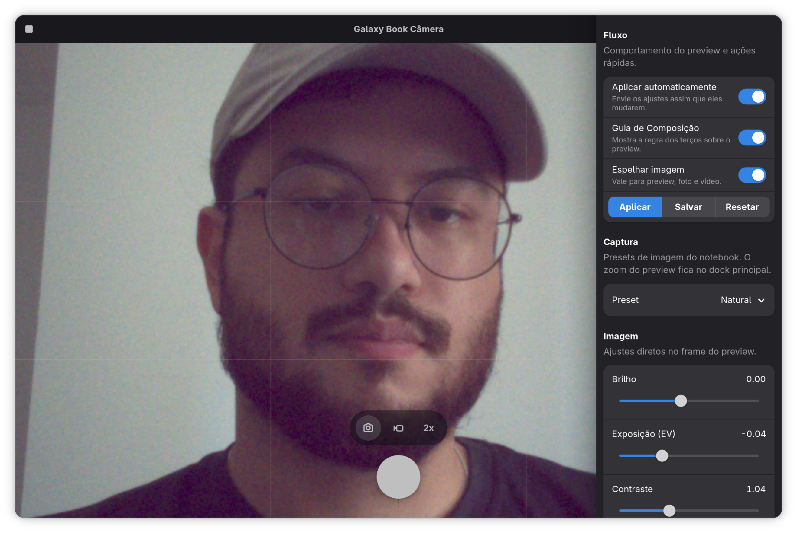
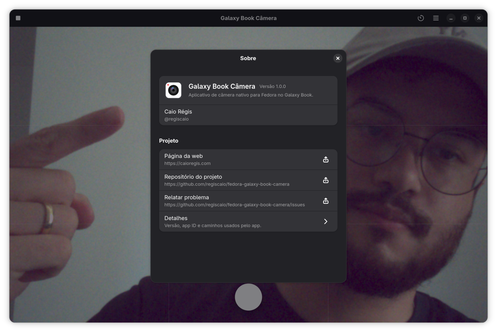

<p align="center">
  
</p>

<h1 align="center">Galaxy Book Camera</h1>

<p align="center">
  <a href="README.md">🇧🇷 Português</a> 
  <a href="README.en.md">🇺🇸 English</a> 
  <a href="README.es.md">🇪🇸 Español</a> 
  <a href="README.it.md">🇮🇹 Italiano</a>
</p>

## Installazione rapida

Per installare l'app dal repository DNF pubblico:

```bash
sudo dnf config-manager addrepo --from-repofile=https://packages.caioregis.com/fedora/caioregis.repo
sudo dnf install galaxybook-camera galaxybook-setup
```

L'app rimane indipendente dal driver; usa Galaxy Book Setup per predisporre e
validare la fotocamera interna.

`Galaxy Book Camera` è un'app fotocamera per Fedora sui notebook Samsung
Galaxy Book, con focus attuale sul **Galaxy Book4 Ultra**. L'app usa
`libcamera` direttamente, ha una UI GNOME nativa con `GTK4` e `libadwaita`, ed
è stata pensata per funzionare insieme al driver pacchettizzato in
[`fedora-galaxy-book-ov02c10`](https://github.com/regiscaio/fedora-galaxy-book-ov02c10).

Questo repository copre solo il **lato userspace**: interfaccia, acquisizione
foto, registrazione video e regolazioni dell'immagine. Il modulo del kernel
vive in un repository separato.

## Interfaccia attuale

### Schermata principale



### Finestra modale `Informazioni`



## Stato attuale

Nello stato validato ad agosto 2026, l'app copre già il flusso principale
della fotocamera sul Galaxy Book4 Ultra:

- anteprima diretta via `libcamera`;
- foto e video con UI GNOME nativa;
- zoom esposto nel dock principale;
- tuning dedicato del sensore `ov02c10` per ridurre il fallback completamente
  `uncalibrated` di `libcamera`;
- integrazione con il driver `ov02c10` pacchettizzato e con `Galaxy Book Setup`.

Il flusso per browser, Meet, Discord, Teams e altre app WebRTC continua a
dipendere dal setup dell'host, quindi quel percorso resta documentato e
automatizzato in `Galaxy Book Setup`.

Nello stato attuale dello stack, anche l'app fotocamera nativa di Fedora/GNOME
può già funzionare su questo notebook. Tuttavia i due percorsi non producono
esattamente lo stesso risultato visivo:

- l'app nativa di Fedora tende a mostrare un'immagine più elaborata, con
  colore, bilanciamento del bianco e aspetto generale più “pronti”;
- `Galaxy Book Camera` usa un percorso diretto via `libcamera`, visivamente
  più grezzo e più vicino al sensore, preservando più dettaglio fine e
  offrendo un controllo molto più flessibile sull'immagine.

In pratica, l'app nativa può sembrare migliore nel colore nello stato
predefinito, mentre `Galaxy Book Camera` tende a offrire più dettaglio e più
margine di regolazione.

## Perché esiste un'app dedicata

L'app fotocamera nativa di GNOME è stata un riferimento importante per
l'interfaccia e l'integrazione con il desktop, ma da sola non risolve il caso
specifico del Galaxy Book4 Ultra.

Su questo hardware, la webcam dipende da una combinazione più delicata tra:

- driver `ov02c10` fuori dal percorso puramente in-tree del kernel;
- stack Intel IPU6;
- `libcamera` e il pacchetto di moduli IPA `libcamera-ipa`;
- bridge per browser e applicazioni di comunicazione quando necessario.

In pratica, il percorso generico del desktop non era sempre il posto migliore
per validare il sensore, l'anteprima e le regolazioni specifiche di questo
notebook. `Galaxy Book Camera` esiste proprio per:

- parlare direttamente con `libcamera` nel flusso principale della fotocamera;
- caricare un tuning specifico del sensore `ov02c10`;
- esporre l'interfaccia e i controlli che avevano senso per questo hardware;
- dare priorità a dettaglio e controllo fine della cattura, invece di
  dipendere solo dal processing standard del percorso generico del desktop;
- separare l'uso quotidiano della fotocamera dal flusso di riparazione,
  diagnostica e bridge, che è rimasto concentrato in `Galaxy Book Setup`.

In altre parole: l'obiettivo non era “sostituire l'app nativa di Fedora per
gusto”, ma creare un percorso stabile e controllabile per un hardware che ha
richiesto una soluzione dedicata.

## Ambito

Il progetto offre:

- anteprima integrata nella finestra principale;
- selettore di zoom nel dock principale, con livelli `1x`, `2x`, `3x`, `5x` e
  `10x`;
- acquisizione foto alla massima risoluzione still esposta dalla fotocamera;
- registrazione video con audio opzionale;
- tuning dedicato `ov02c10.yaml` per il percorso diretto di `libcamera`;
- conto alla rovescia di `3s`, `5s` o `10s` per foto e avvio video;
- preferenze persistenti per immagine e comportamento;
- post-processing calibrato per ridurre dominanti verdi e azzurre più
  aggressive in ombre profonde ed estremi di luce;
- dialogo `Informazioni` nativo in `libadwaita`, con link e sezione
  `Dettagli`;
- integrazione con launcher `.desktop`, icona propria e finestra GNOME nativa;
- regolazioni come luminosità, esposizione, contrasto, saturazione, tonalità,
  temperatura, tinta, RGB, gamma, nitidezza e specchiatura.

Questo progetto **non** offre:

- la patch del modulo `ov02c10`;
- bridge webcam virtuale per app che dipendono strettamente da V4L2;
- correzioni specifiche dello stack `PipeWire`/`xdg-desktop-portal` dell'host.

## Requisiti runtime

Per far funzionare l'app su questo hardware, il sistema deve avere:

- `libcamera`;
- `libcamera-ipa`;
- `GTK4` e `libadwaita`;
- `ffmpeg-free` di Fedora oppure `ffmpeg` di RPM Fusion.

L'RPM di questa app è esclusivamente userspace: non installa, aggiorna né
riconcilia il driver del kernel. Per usare la fotocamera interna su questo
hardware, **Galaxy Book Setup** deve predisporre e validare `ov02c10`/`akmods`.
Senza questo passaggio, l'app resta installabile e testabile, ma il sensore
interno potrebbe non essere enumerato.

## Installazione per utenti

### Tramite repository DNF pubblico

Il percorso consigliato per gli utenti finali è installare dal repository
pubblico:

```bash
sudo dnf config-manager addrepo --from-repofile=https://packages.caioregis.com/fedora/caioregis.repo
sudo dnf install galaxybook-camera galaxybook-setup
```

Apri Galaxy Book Setup per completare predisposizione, riparazione e
riconciliazione del driver della fotocamera interna; riavvia quando richiesto. Il
pulsante di aggiornamento della fotocamera aggiorna solo `galaxybook-camera`.

### Tramite RPM locali

Se l'RPM dell'app è stato generato localmente, può essere installato in modo
indipendente:

```bash
sudo dnf install /percorso/verso/galaxybook-camera-*.rpm
```

Per la fotocamera interna, installa ed esegui Galaxy Book Setup separatamente.
Dopo la predisposizione, `akmods` deve compilare e installare il modulo del
kernel. Se `Secure Boot` è abilitato, la firma tramite `akmods` deve essere
configurata; altrimenti il modulo può essere compilato ma non caricato al boot.

Se la fotocamera continua a fallire dopo il riavvio, i controlli più utili
sono:

```bash
journalctl -b -u akmods --no-pager
modinfo -n ov02c10
journalctl -b -k | grep -i ov02c10
```

Il risultato atteso è `ov02c10` proveniente dal modulo generato da `akmods`,
non dalla copia in-tree del kernel.

## Uso

Dopo l'installazione e il riavvio, l'app può essere aperta dal menu GNOME con
il nome **Galaxy Book Câmera** quando il sistema è in `pt_BR`.

Comportamento attuale:

- le foto vengono salvate in `XDG_PICTURES_DIR/Camera`;
- i video vengono salvati in `XDG_VIDEOS_DIR/Camera`;
- la fotocamera viene acceduta direttamente via `libcamera`, senza dipendere
  da Snapshot;
- l'RPM installa il tuning del sensore in
  `/usr/share/libcamera/ipa/simple/ov02c10.yaml`, il percorso globale del
  `simple IPA`;
- se la fotocamera non è ancora registrata all'avvio dell'app, l'anteprima la
  enumera di nuovo con backoff limitato a `5s`; **Ferma anteprima** annulla
  subito l'attesa e un nuovo avvio riavvia il ciclo;
- il preset `Natural` e il baseline predefinito usano una regolazione leggera
  e calibrata per avvicinare il colore al percorso webcam del sistema senza
  perdere il dettaglio del `libcamera` diretto;
- il post-processing dell'anteprima e della cattura neutralizza parte delle
  dominanti verdi e azzurre più aggressive in ombre profonde ed estremi di
  luce, senza abbandonare il carattere più grezzo del pipeline diretto;
- lo zoom dell'anteprima usa un selettore inline nel dock principale,
  mantenendo l'app più vicina alla logica di una camera mobile senza
  abbandonare il layout GNOME.

## Limitazioni note

- Il focus di questo repository è l'app fotocamera con UI GNOME nativa. La
  visibilità della fotocamera in app come Snapshot, browser, Meet, Teams o
  Discord dipende dallo stack dell'host (`PipeWire`, `WirePlumber`,
  `libcamera`, `xdg-desktop-portal`) e non viene risolta solo da questo
  pacchetto. Per questo scenario, il flusso consigliato è usare `Galaxy Book
  Setup`.
- Il supporto è stato sviluppato e validato principalmente sul **Galaxy Book4
  Ultra**. Altri modelli della linea Galaxy Book possono richiedere regolazioni
  aggiuntive nel driver, nell'ACPI o nel pipeline della fotocamera.

## Relazione con il driver e con il fix comunitario

Il modulo del kernel usato da questa app vive in:

- <https://github.com/regiscaio/fedora-galaxy-book-ov02c10>

Il lavoro su questo driver parte dagli apprendimenti del repository
comunitario:

- <https://github.com/abdallah-alkanani/galaxybook3-ov02c10-fix/>

L'attuale separazione tra repository esiste per mantenere responsabilità
chiare:

- `fedora-galaxy-book-ov02c10`: modulo del kernel e packaging `akmod`;
- `fedora-galaxy-book-camera`: app GNOME e packaging RPM dello userspace.

Il pulsante di aggiornamento di questa app aggiorna solo
`galaxybook-camera`. Installazione, riparazione e aggiornamento del driver sono
gestiti da `Galaxy Book Setup`, che può validare insieme modulo e kernel in uso.

## Build e packaging

Dipendenze di build su Fedora:

```bash
sudo dnf install cargo rust pkgconf-pkg-config gtk4-devel libadwaita-devel libcamera-devel
```

Se l'host non ha il toolchain completo, il `Makefile` usa un container
rootless con `podman`.

Comandi principali:

```bash
make build
make test
make self-test
make smoke-test
make dist
make srpm
make rpm
```

`make self-test` verifica configurazione, immagine e video con un frame
sintetico e non richiede una fotocamera. `make smoke-test` è il test di salute
dell'hardware: fallisce se non viene enumerata alcuna fotocamera e richiede
acquisizione, configurazione e cattura reali con timeout.

Il binario generato localmente si trova in:

```bash
./target/release/galaxybook-camera
```

Il launcher locale di sviluppo può essere installato con:

```bash
make install-local
```

File rilevanti:

- spec RPM: [`packaging/fedora/galaxybook-camera.spec`](packaging/fedora/galaxybook-camera.spec)
- launcher: [`data/com.caioregis.GalaxyBookCamera.desktop`](data/com.caioregis.GalaxyBookCamera.desktop)
- metadati AppStream: [`data/com.caioregis.GalaxyBookCamera.metainfo.xml`](data/com.caioregis.GalaxyBookCamera.metainfo.xml)

## Licenza

Questo progetto è distribuito sotto la licenza **GPL-3.0-only**. Vedi il file
[LICENSE](LICENSE).
